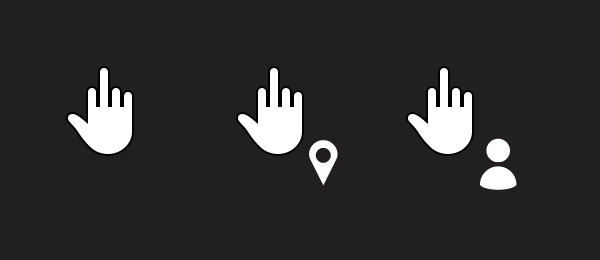
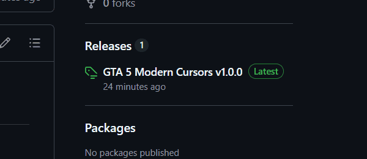

# GTA 5 Middle Finger Cursors (Windows 11 Style)

The iconic middle finger cursor from the GTA V in-game browser, remade in the clean **Windows 11** style. Smooth edges, native drop shadow, and full DPI scaling (`32×32` to `128×128`).

## What's inside
* `gta5_link.cur` — Link select
* `gta5_pin.cur` — Location select
* `gta5_person.cur` — Person select
* `Install.inf` — One-click installer

## Installation
1. Grab the `.zip` archive from **[Releases](../../releases)** and extract it.
2. Right-click **`Install.inf`** -> *Show more options* -> **Install**.
3. Go to **Mouse Settings -> Additional mouse settings -> Pointers**, pick **`GTA 5 Modern (Win 11 Style)`**, and hit **Apply**.

---

## Установка
1. Скачай `.zip`-архив из **[Releases](../../releases)** и распакуй в любую папку.
2. Нажми ПКМ по **`Install.inf`** -> *Показать дополнительные параметры* -> **Установить**.
3. Открой **Параметры мыши -> Дополнительные параметры мыши -> Указатели**, выбери схему **`GTA 5 Modern (Win 11 Style)`** и нажми **Применить**.
